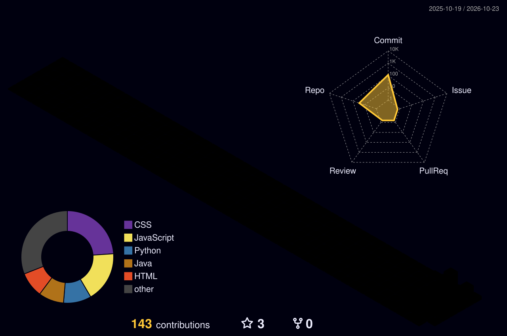

<div align="center">


<br>

<h3>Desenvolvimento · Linux · Open Source</h3>

<a href="https://github.com/joaofantindev?tab=repositories"></a>
<a href="https://github.com/joaofantindev?tab=followers"></a>

</div>

---

## `whoami` 🧑‍💻

```text
João | Desenvolvedor | Linux & Open Source
```

Gosto de explorar ferramentas, sistemas e linguagens diferentes — do baixo nível à infraestrutura. Este perfil reúne projetos, experimentos e coisas que estou aprendendo.

## ⚙️ Tecnologias

<div align="center">


<br>

<br>


</div>

## 📊 GitHub

<div align="center">

<table width="100%" border="0" cellpadding="6" cellspacing="0"
  style="width: 100%; border: 0; border-collapse: collapse;">
  <tr>
    <td width="50%" align="center" style="width: 50%; vertical-align: middle;">
      
    </td>
    <td rowspan="2" width="50%" align="center"
      style="width: 50%; vertical-align: middle;">
      <a href="https://github.com/joaofantindev">
        
      </a>
    </td>
  </tr>
  <tr>
    <td width="50%" align="center" style="width: 50%; vertical-align: middle;">
      <a href="https://github.com/joaofantindev">
        
      </a>
    </td>
  </tr>
</table>

</div>

## 🧊 Contribuições em 3D

<div align="center">



</div>

---

<div align="center">


<sub>Feito com curiosidade, café e commits ☕</sub>

</div>

