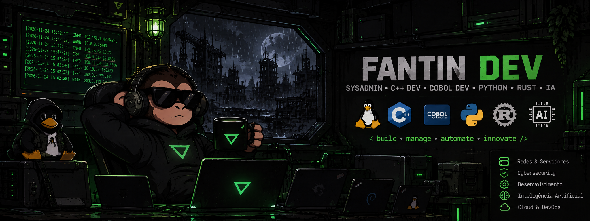

 

# João Fantin

**Backend Engineering · Automation · Infrastructure**

*Building systems, exploring technology, and solving problems through code.*

---

## About Me

I'm a software developer focused on backend engineering, system architecture, automation, and infrastructure.

I enjoy understanding how things work under the hood, from application logic and database design to networking, Linux environments, and distributed systems.

My approach to software development is centered around writing clean, maintainable code, understanding the problem before choosing the technology, and building solutions that are reliable beyond the development environment.

I'm constantly exploring new technologies, improving my engineering skills, and learning how to integrate automation and AI into modern software development workflows.

**Areas of Interest**
- Backend Engineering & API Development
- Software Architecture & Design Patterns
- Database Design & Optimization
- Automation & Distributed Systems
- Linux, Networking & Infrastructure
- Cybersecurity & System Security
- Cloud Computing & Containerization

---

## Technology Stack

### Backend Development

### Databases & Data Management

### Infrastructure & DevOps

### Development Tools

---

## Engineering Mindset

I believe good software engineering goes beyond knowing programming languages.

It's about understanding the entire environment where software lives:

- **Architecture:** Designing systems that are maintainable and scalable.
- **Performance:** Understanding bottlenecks and optimizing where it matters.
- **Security:** Building with security in mind from the beginning.
- **Infrastructure:** Understanding deployment, containers, networking, and Linux.
- **Automation:** Eliminating repetitive work through intelligent tooling.

My goal is to become a well-rounded engineer capable of working across the entire software lifecycle.

---

## GitHub Statistics

 

  

---

## Contribution Activity

---

*Engineering is a continuous process of learning, building, breaking, and improving.*

